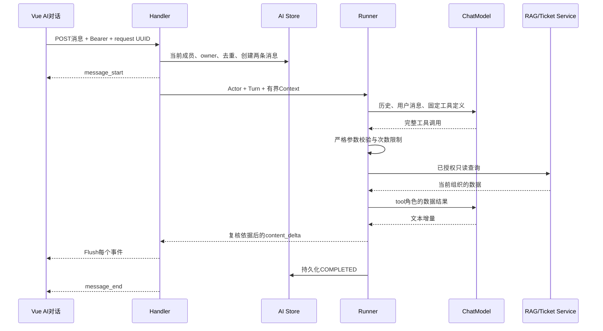

# W08 对话与工具调用流程

入口在 `cmd/api/main.go`：现有 TicketService、RAGService 实例同时交给 AI Runner；Store 持有 PostgreSQL 和 TicketService；Handler 接入 RequireUser 保护组。API 启动不请求模型，也不依赖 Redis。旧 `/knowledge/ask` 保持非流式，新的 `/ai/.../messages` 使用流式协议。

模型只提出调用，Go 决定是否执行。第一次调用模型给出工具名与参数，适配器收齐所有碎片并确认结束后，Runner 才校验与执行。执行结果回传为 `role:tool`，之后再调用模型生成解释。一个完整用户轮次可能包含多个上游模型请求。

限制：全轮60秒、单模型请求35秒、最多3个工具轮次/4次工具调用/1个建单提议、最多4次模型请求；实例最多2个生成；输入24KiB、累计输出16KiB，单模型输出预算2048token。最近20条历史先裁剪到保守预算；本轮工具调用和结果不拆开截断。预算不足返回AI_LIMIT，不无限重试。

原生 DeepSeek 走固定 `https://api.deepseek.com/chat/completions`，禁代理/重定向，关闭thinking，使用CHAT_MODEL。原生 Ollama 使用配置中的显式回环 `/api/chat`。两者统一为 `internal/ai/model.ChatModel` 的 TextDelta/ToolCallReady/Usage/Completed；失败通过error返回。没有SDK、Agent框架或供应商协议泄露到前端。

保存USER与ASSISTANT，不保存私密上游完整prompt或工具内部对话；引用和提议独立保存。只展示创建者在该组织的会话。会话列表最新50条，消息/提议各最新100条；当前没有归档、全量分页和断流重放。旧助手带引用的内容不再进入后续模型上下文，需要知识时重新查证。

阅读顺序：`main.go` → `internal/ai/handler.go` → `chat.go` → `runner.go` → `tools.go` → `store.go/approval.go` → `internal/platform/llm/stream.go`。修改一个工具，先看其JSON契约、业务Service权限，再修改验证和测试；不要直接加一段SQL到Runner。

多轮历史保留已处理的ASSISTANT轮次标记；带引用/未完成的旧助手内容替换为服务端固定占位说明，既不继续发送旧私密片段，也不把旧USER消息误当待处理任务。模型只处理最后一条用户请求。
