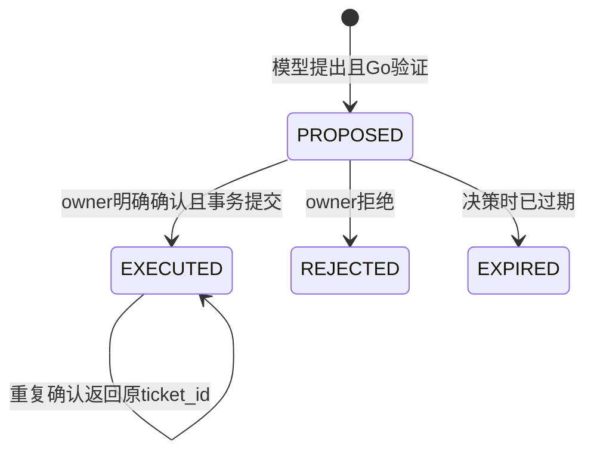

# 建单提议与确认事务

模型只保存PROPOSED提议。卡片从数据库Action生成，显示完整标题/正文/优先级、组织、提出者、15分钟有效期。用户确认只发送动作ID；客户端不能替换title、org_id或confirmed_by_user_id。

状态EXPIRED在确认/拒绝时按数据库时钟判定并持久化，没有后台过期扫描器。拒绝与重复拒绝是幂等的；拒绝后确认冲突。停掉生成不会自动拒绝已保存提议，仍必须明确确认才执行。

事务锁序：当前成员行FOR SHARE → 会话owner行FOR UPDATE → 提议行FOR UPDATE。成员锁会与UPDATE/DELETE冲突，确认与并发撤权按数据库锁序串行化。组织admin不能确认另一人的提议。

读取已保存JSON → 再次规范化 → 检查规范化前后相同及SHA256匹配 → 调用 `TicketService.CreateInTransaction` → 复用现有创建SQL和TICKET_CREATED事件 → 更新提议EXECUTED/ticket_id/confirmed_by/confirmed_at → COMMIT。事件after_data包含ai_proposal_id，可从工单追溯提议。普通手动建单继续用同一个内部helper。

Ticket、事件、提议完成三者在同一个pgx.Tx中。任一INSERT、UPDATE或延迟约束在COMMIT时失败，全部回滚。不能先TicketService.Create提交工单，再单独更新提议，否则请求重试会生成第二张。

第二个确认请求等待同一行锁；第一个提交后读到EXECUTED，返回原ticket_id，不再创建。网络在提交确认时断开属于提交结果可能未知的边界，客户端重新获取/再次确认，以数据库状态为准。

UUID不替代授权。复合FK保证消息、会话、提议、成员、工单属于同组织；助手角色FK阻止将USER消息绑定为提议来源；唯一索引约束每助手最多一个提议。摘要不是对拥有数据库写权限者的防篡改签名（数据库管理员可同时改参数和摘要），用于检测应用链路意外修改和不一致。

FAILED/INTERRUPTED清理只允许原owner、原org、原assistant且仍STREAMING，允许在成员撤销后结束已存在运行，不能新建记录或读历史。COMPLETED仍需当前active权限。
