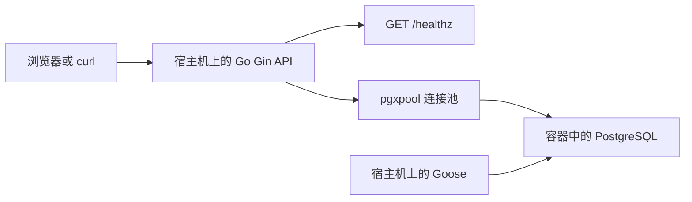
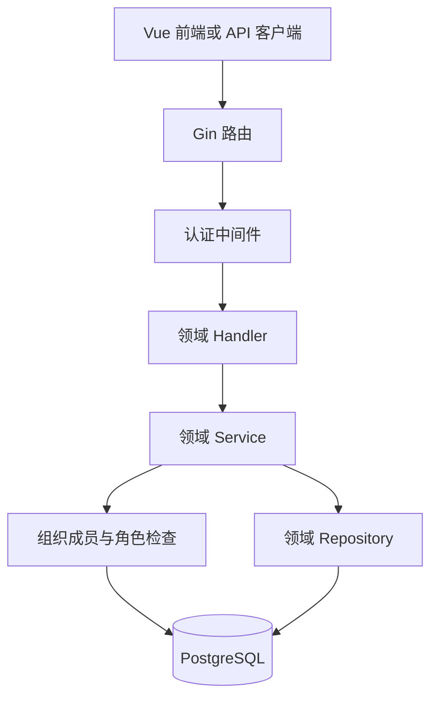

# NexusDesk 架构说明

> W12 当前交付：39业务API、14迁移、10主要页面；请先读[当前架构](release/architecture.md)、[API索引](release/api-index.md)和[功能边界](release/acceptance.md)。下文保留历史设计与逐周增量，旧阶段限制不代表当前能力。

> 2026-11-11当前阶段：API + 独立cmd/worker、PostgreSQL业务任务、专用Redis/Asynq、本地Ollama；设计见[异步任务](jobs-design.md)，实际验收见[第七周记录](weekly/week07.md)。旧段落保留历史。

- 版本：v0.2
- 日期：2026-11-10（W02 Day 1 增量更新）
- 用途：第一周 Day 2 架构设计产出。
- 依据：[需求说明](requirements.md)、[原始项目设计](../项目开发文件/01_NexusDesk_完整项目设计文档.md)。
- 状态：由 AI 按开发者要求整理；W1/W2基础与W03工单九接口、状态机、软删除和同tx事件已实现验证；W04已增加条件UPDATE领取与Vue/TS本地前端，角色修改仍待后续，实际证据见[第四周](weekly/week04.md)。

> 阅读顺序建议：先看第 1～4 节理解系统与分层，再看第 5～7 节理解权限、事务和启动。除明确标记已实现的内容外，文中的目录、流程和测试均为设计；运行证据以周报为准。

W02 Day 1 已形成 [认证设计](auth-design.md)、[权限矩阵](authorization-matrix.md)、[API 契约](api/auth-organization.md) 与 [ADR-0002](decisions/0002-auth-security.md)。本周只落地 admin/member、active/disabled；support、角色变更与第6.3节成员撤权锁方案仍为后续设计；W04领取方案以ADR-0004为准。

W02 Day 2 已添加 users 与 organization_members 增量迁移，并在专用测试库验证；[Repository 契约](repository-contracts.md) 定义了八个方法。Day 3 落实三个用户存储方法与注册，Day 4 增加 LoginService/Handler、TokenManager 与四个 JWT 配置。启动入口注入同一个 PasswordHasher、预建 dummy hash；Token 不携带角色。Day 5 已接通 RequireUser 与 /me，落实组织创建和本人列表两个存储方法，Day 6已落实成员三方法与MemberService/Handler/policy。组织创建采用 Service 定义原子动作、专用 Repository 方法内部持有同一 tx 的方式；W03工单已按第6节由Service显式管理小事务接口，Repository只执行SQL。

## 1. 架构目标与阶段边界

项目采用模块化单体：一个 Go API 程序，在进程内部按认证、组织和工单划分职责。业务数据由 PostgreSQL 保存。后续文档处理引入同仓库的独立 Worker 进程，届时再接入 Redis、文件存储和模型服务。

| 阶段 | 实际实现范围 | 尚未实现的范围 |
| --- | --- | --- |
| W1 | Go 启动入口、环境配置、Gin、健康检查、PostgreSQL 连接池、首条组织表迁移 | 身份认证、业务 Service / Repository、前端、Worker |
| W2 | Day 6已完成注册/登录、密码/JWT、认证中间件、本人信息、组织/admin事务、本人组织列表、成员读取/添加和RBAC | Day 7工程收尾已归档；角色修改、停用接口、support 和工单留后续阶段 |
| W3 | 工单创建、查询、编辑、评论、状态机和操作事件 | 前端与完整并发验收 |
| W4 / G1 | 并发领取验证、最简 Vue 前端、业务端到端演示 | 知识库和 AI |
| W5 | 私有文档、组织隔离、TXT/MD提取、知识库和首次使用页面 | RAG、Worker、SSE 和受控工具调用仍待后续 |

设计六张表和未来业务分层，是为了提前明确边界；W1 只实际创建 `organizations` 表。

## 2. 系统结构

### 2.1 第一周实际运行结构



- Go API 在宿主机运行，PostgreSQL 在本地容器运行。
- API 使用宿主机地址和映射端口连接数据库；此阶段不能直接把 Compose 服务名 `db` 当作宿主机可解析地址。
- Goose 是独立的迁移命令，不放进 HTTP Handler，也不在每次 API 启动时自动执行。
- `/healthz` 返回固定状态，验证 HTTP 服务可以响应；数据库在启动阶段单独验证连接。健康响应不表示全部依赖持续可用。
- 后续若需要依赖就绪检查，再设计 `/readyz`；W1 不提前增加该接口。

### 2.2 首个业务版本的请求结构



第一周的 `/healthz` 是公开接口，不经过用户身份认证。认证中间件和领域模块在相应周次增加。

## 3. 目录与模块职责

### 3.1 W1 按需建立的目录

| 路径 | 职责 |
| --- | --- |
| `cmd/api/main.go` | 组合依赖，按顺序启动，管理退出；不承载工单规则 |
| `internal/platform/config/` | 读取、校验环境配置，返回明确错误 |
| `internal/platform/httpserver/` | 创建 Gin 引擎、注册健康检查及 HTTP 服务公共设置 |
| `internal/platform/database/` | 创建和关闭 pgxpool，提供启动时的连通性验证 |
| `migrations/` | 保存按版本演进的 SQL 迁移 |
| `deploy/` | 保存本地 PostgreSQL 的 Compose 配置 |
| `docs/` | 保存需求、架构、表设计、决策和学习记录 |

Day 2 仅新增设计文档。目录表中的 Go 文件、Compose 和 migration 留到手册对应阶段创建。

### 3.2 后续逐步增加的领域模块

| 模块 | 负责什么 | 边界 |
| --- | --- | --- |
| `internal/auth/` | 注册、登录、密码验证、凭据校验 | 用户身份不等于组织内业务权限 |
| `internal/organization/` | W02 组织创建、本人组织、成员查询与添加、有效角色；角色变更后续评审 | 管理员权限限定在当前组织 |
| `internal/ticket/` | 工单、评论、状态机、领取与事件 | 不接受客户端自行指定可信身份或角色 |

优先按领域组织文件，例如工单模块内部逐步增加 Handler、Service 和 Repository；不提前生成大量空接口。

依赖组合放在启动入口：创建数据库、组织能力和领域服务，再注入路由。HTTP 公共基础设施通过传入的 Handler 或注册函数接入领域接口，避免平台包与领域包互相导入。

工单模块通过明确的成员查询/校验能力使用组织模块，不直接访问组织模块私有 Repository。跨模块调用先采用普通 Go 方法，不引入内部 HTTP 或消息队列。

## 4. Handler、Service、Repository 怎样分工

| 层次 | 负责 | 不适合承担的工作 |
| --- | --- | --- |
| Handler | 解析请求、基础格式校验、取得认证上下文、调用 Service、映射 HTTP 响应 | 决定工单状态机、直接执行 SQL |
| Service | 组织与对象授权、业务校验、状态转换、事务边界 | 依赖 Gin Context、决定 HTTP 响应格式 |
| Repository | 参数化 SQL、组织过滤、条件更新、数据库结果转换 | 决定 HTTP 状态码、凭 SQL 外键代替完整业务授权 |

基础格式校验检查请求能否被正确解析；业务不变量由 Service 保证。调用者即使换成测试或未来的工具调用，也必须经过相同业务检查。

### 4.1 创建工单的数据流

1. 认证中间件验证凭据，得到可信的当前用户 ID。
2. Handler 解析标题、描述和优先级，取得待访问的组织标识。
3. Service 检查当前用户是否为该组织的有效成员。
4. Service 确认参数符合需求，设置创建人为当前用户、状态为 `OPEN`、处理人为空。
5. 在同一事务中写入工单和创建事件；任意写入失败都回滚。
6. Handler 将成功结果映射为 HTTP `201`，返回工单标识和必要数据。

前端可以提供“想访问哪个组织”，但该选择必须经过成员关系校验。前端提交的 `creator_id`、`role`、初始 `status` 或 `assignee_id` 不得直接写入可信业务字段。

### 4.2 评论与事件的区别

- 评论保存沟通内容，例如补充复现步骤。
- 事件保存业务变化，例如领取、编辑、解决、关闭和重新打开。
- 解决说明和重新打开原因保存到对应事件，供工单历史展示；无需再强制生成一条重复评论。
- 评论和事件的读取都以所属工单的可见范围为前提。

## 5. 身份与组织权限

本周七个 API 的授权使用专门的 [W02 权限矩阵](authorization-matrix.md)：active member/admin 都可读成员列表，添加只允许 active admin；不提供角色变更。下表按W03更新，support仍不是允许值。

授权依次处理三件事：用户身份是否有效、是否为当前组织有效成员、是否有权操作目标工单。

| 身份或角色 | 工单可见范围 | 关键业务限制 |
| --- | --- | --- |
| 未登录 | 无 | 业务接口返回 `401` |
| `member` | 本组织全部未删除工单/评论/事件 | 仅编辑本人OPEN，active assignee可启动/解决，W04可领取未指派OPEN |
| `support` | 尚无此角色取值 | 未来扩展需增量迁移 |
| `admin` | 本组织全部未删除工单/评论/事件 | 编辑/指派OPEN、按状态机操作、软删除；无角色修改API |

角色来自 `organization_members`，不使用前端字段或旧凭据中的角色作为唯一事实来源。有效成员状态也需要检查。

W03工单查询必须限定org_id和deleted_at IS NULL，所有active成员可读；creator_id只用于member编辑OPEN的对象策略。评论和事件必须同时匹配当前组织与目标工单，禁止通过子资源 ID 绕过工单授权。

错误语义遵循需求稿：

- `400`：输入内容或格式不满足要求。
- `401`：未登录或凭据无效。
- `403`：已可见资源上的操作不被允许，或无权执行组织管理操作。
- `404`：资源不存在、跨组织或对当前用户不可见。
- `409`：状态不符合操作条件、领取冲突、最后一名管理员降级等业务冲突。
- `500`：未预期内部失败，向客户端返回摘要，内部保留不含凭据的排查日志。

错误检查顺序先保证身份与数据可见性，再披露状态细节。对同组织支持人员的解决请求，先验证允许的源状态，再验证当前处理人，以区分需求中的非法状态与非本人处理场景。

## 6. 事务与并发规则

### 6.1 事务由 Service 协调

Service 开始事务，并让相关 Repository 使用同一个事务对象。禁止工单使用事务连接、事件却使用连接池直接写入，造成部分成功。

事务内任意一步失败都返回错误并回滚；只有全部写入成功才提交。返回成功响应之前必须确认提交成功。

初期可用小范围的查询执行接口让 Repository 兼容连接池和事务，不建立通用仓储框架。

### 6.2 领取与状态变更

- W04领取使用带org_id/id/OPEN/assignee IS NULL/deleted_at IS NULL/expected_version/版本防溢出的单条UPDATE RETURNING，竞争最多一成功；保持OPEN、version+1，同tx写一条TICKET_ASSIGNED。零行按范围读区分404/409。见[ADR-0004](decisions/0004-atomic-ticket-claim.md)。
- 状态变更使用明确源状态条件或行锁；影响记录为零时，结合已验证的可见性判断是否返回冲突。
- 业务修改递增 `version`，事件保存该次版本；评论不修改工单状态，不递增工单版本。
- 工单变更和事件在同一事务提交。Go 进程内 Mutex 不能替代数据库对多个应用实例的协调。
- 不自动重试已经可能产生副作用的整个 HTTP 请求；创建幂等按后续计划另行设计。

### 6.3 角色变更与工单操作的一致性建议

本节为后续角色管理与工单阶段的方案；W02 不实施角色或状态修改，也不声称本周验证了这些并发规则。

需求还包含两个跨记录规则：不能同时降级最后的管理员，不能把仍负责未关闭工单的支持人员降为其他角色。仅“先查询、后更新”存在竞争窗口。

P0 建议采用 `READ COMMITTED` 事务隔离级别和统一的组织行锁约定，具体 SQL 随后续角色管理与工单功能实现并验证。取得组织锁后，再用新的查询读取成员和业务状态；不能复用等待加锁之前的授权结果。若更换隔离级别，需要重新验证快照可见性与重试策略。

锁定顺序：

1. 所有涉及工单、评论及成员角色的业务写事务，先锁定所属 `organizations` 行。
2. 工单与评论写操作取得共享行锁（`FOR SHARE`），再读取并验证成员资格，最后访问目标工单。
3. 成员角色变更取得排他行锁（`FOR UPDATE`），在锁内重新确认操作者权限、剩余管理员和目标成员负责的未关闭工单，再更新角色。
4. 初始组织与首名管理员在一个事务中建立；P0 不提供成员删除或停用接口，后续新增时同样遵守锁约定并补充测试。

共享锁允许同组织工单操作并发，角色修改会与这些写事务互斥。统一按“组织 → 工单”的顺序加锁，避免不同路径反向加锁。该方案增加角色变更的等待成本，适用于当前规模，仍需真实并发测试，不能据设计宣称已保证正确。

详细约束及验证场景见 [数据库设计](database.md)。

## 7. W1 配置、启动与退出

### 7.1 配置来源

`APP_ENV`、`HTTP_ADDR` 和数据库连接字段通过环境变量读取。真实密码保存在本地 `.env`，示例值写入 `.env.example`。

Go 的环境变量读取不会自动加载 `.env`；本地启动时由当前 Bash 终端的加载步骤或后续开发脚本注入。具体可执行命令在 Day 3～5 和 README 中补齐。

### 7.2 启动顺序

```text
读取并校验配置
    → 建立应用生命周期 Context
    → 创建 pgxpool 并用有超时的 Context 执行 Ping
    → 创建路由与 HTTP 服务
    → 开始监听
```

- 数据库验证失败时明确报错并退出，不继续对外监听业务接口。
- 建立连接池不等于已经证明数据库可连接，需要实际 Ping。
- 不在日志中打印密码、完整连接字符串或认证凭据。
- W1 数据库接入前，可以先独立跑通健康检查；接入后再采用完整启动顺序。

### 7.3 退出与请求取消

- 启动失败、正常退出时都释放已经创建的资源。
- 收到退出信号后，使用独立且有超时的退出 Context 停止 HTTP 接收和等待在途请求，再关闭连接池。
- 请求中的数据库调用接收请求 Context，让取消与超时能够向下传播。
- 不把已经取消的应用 Context 直接当作优雅退出的等待 Context。

## 8. 后续扩展边界

文档和 AI 功能按周计划加入。Worker 与 API 可同仓库、独立进程运行；耗时解析不长期占用 HTTP 请求。

模型适配器处理外部模型请求，业务 Service 继续负责组织权限与写操作规则。未来工具调用也必须进入既有 Service，不能绕过它直接执行 SQL。

Redis、模型服务和知识库故障不能成为普通工单业务的必经依赖。具体降级与超时在相应阶段设计，不在 W1 接入这些依赖。

## 9. 设计验证与学习交接

| 验证内容 | 预期证据 | 实施阶段 |
| --- | --- | --- |
| 健康检查 | HTTP 200、固定 JSON、httptest | W1 |
| 启动失败与配置 | 缺配置、数据库不可达、端口占用的实际输出 | W1 |
| 权限和角色 | 未登录、非成员、disabled、member/admin 动作和跨组织访问；角色变更另行验证 | W2；角色变更在后续阶段 |
| 事务 | 事件写入失败后工单变更回滚 | W3 |
| 并发 | W2 重复注册/添加成员；后续领取竞争、管理员降级竞争、角色与工单操作竞争 | W2 及后续功能阶段，分别补齐 |
| 业务演示 | 登录、建单、领取、解决、关闭 | W4 |

本文补齐了 Day 2 的架构说明。实现、测试与独立解释能力分别在后续验证；本次没有执行应用测试或创建业务代码。

相关文档：[需求](requirements.md) · [数据库](database.md) · [ADR-0001](decisions/0001-modular-monolith.md)。

## W04浏览器边界

Vue以相对/api/v1调用，开发Vite回环代理至Go；内存Token和会话代次、取消/请求序号防旧数据回写，ID/version无损字符串。职责/启动/真实浏览器验收见[前端说明](frontend/web-mvp.md)和[G1](demo/g1-demo-script.md)。开发代理不等于生产网关或后端授权。

## W05 当前入库模块

启动入口将pgx仓库、既有MemberRepository、私有Local Storage和UTF-8 Extractor注入knowledge.Service。Handler在RequireUser保护组注册七接口；服务每次核对成员与对象范围。Vue新增注册、组织创建入口、知识库列表和详情，复用内存Token与请求作用域。

上传先流式保存原文件，再提交元数据，失败用补偿/journal处理；解析先条件UPDATE取得PROCESSING，事务外读文件，再由Repository短事务锁父行、写正文与READY。失败状态用独立短Context且条件更新；不存在跨文件/数据库原子承诺。下载经鉴权Handler流式返回，没有静态目录挂载。

本周HTTP读头5秒、读请求15秒、写响应30秒，操作Context仍限定默认10秒。读取源是本地常规文件，context无法强制打断任意未来远程阻塞reader；更换存储实现需重新验证。PDF只附件模式，无解析器依赖。W06/RAG及W07任务租约尚未实现。

详见[入库设计](knowledge/ingestion-design.md)、[ADR-0005](decisions/0005-private-object-storage.md)、[W05验收](weekly/week05.md)。


## W06增量

同一个Go API注入共享的本地llm.Client和rag.Service，四个接口挂在RequireUser保护组；API启动不依赖模型在线。knowledge负责原文件/正文与授权，rag负责索引编排、版本一致性、检索与引用；llm只负责有界的本地HTTP协议。SQL模型请求分离，写事务5秒/读3秒/独立回滚3秒，生成前后复查来源。

Vue知识库详情加索引面板，新检索问答页走组织作用域，所有来源为纯文本+鉴权文档链接。HTTP服务WriteTimeout75秒以覆盖有界同步流程；预热大模型是独立操作。无Redis/Worker/SSE/工具执行，状态恢复局限与后续方向见[ADR-0006](decisions/0006-local-rag-baseline.md)。

## W07 当前执行结构

浏览器→API→PostgreSQL持久任务；独立Worker扫描任务→Redis/Asynq→Worker执行。Worker复用knowledge/rag Service，在事务外处理文件/模型，用短事务和taskguard发布。API启动不连Redis；Worker没有HTTP/JWT依赖。API和Worker共享同一数据库和私有文件根目录。W06同步端点保留，但与活动异步任务互斥。详见[任务设计](jobs-design.md)和[ADR0007](decisions/0007-durable-asynq-jobs.md)。
