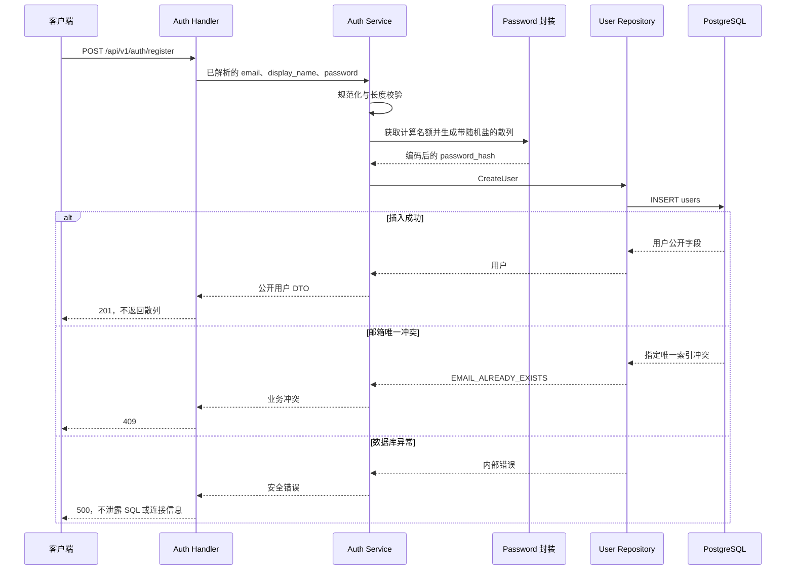
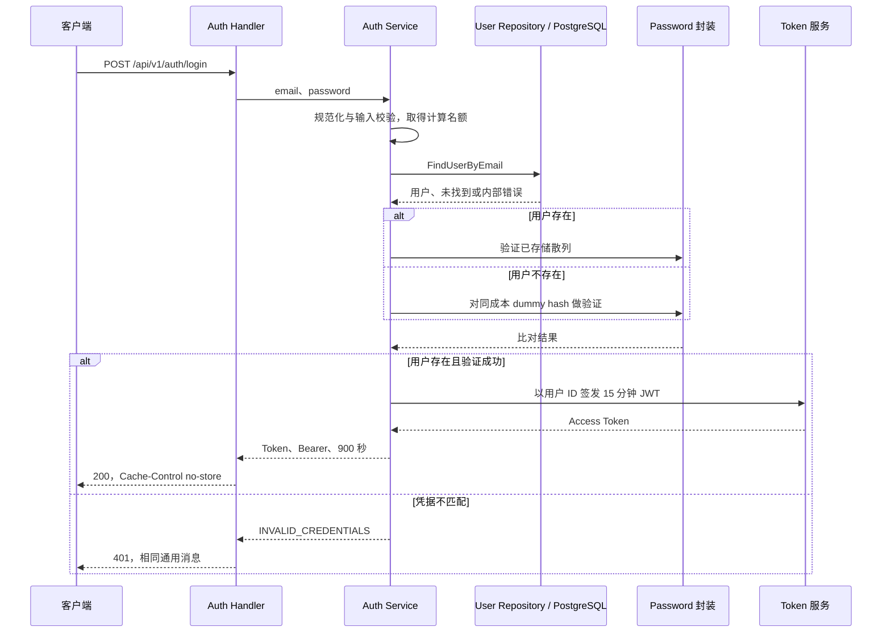

# NexusDesk W02 认证与会话设计

- 日期：2026-11-10；状态：Day 7已完成七接口/RBAC整周审查、回归与演示，学习回答和W3交接已归档；个人复述待开发者记录。
- 依据：[第二周手册](../项目开发文件/每周开发手册/05_NexusDesk_第二周详细开发手册.md)。
- 编写方式：AI 按开发者“全部直接完成”的委托补齐；下文具体参数是受托设计选择，不是个人掌握记录。
- 配套：[API 契约](api/auth-organization.md)、[授权矩阵](authorization-matrix.md)、[ADR-0002](decisions/0002-auth-security.md)、[第二周记录](weekly/week02.md)。

## 1. 范围与已有基础

沿用现有 Go Module、配置加载、Gin Router、pgxpool、PostgreSQL 17 和首条 organizations 迁移。Day 2 增加用户和成员表；Day 3/4 接通注册与登录；Day 5 新增 /me、POST/GET /organizations。Day 6增加GET/POST /organizations/:orgID/members，原有GET /healthz保留，七个业务接口均已实现。

第二周增加注册、登录、当前用户、组织创建、本人组织列表、组织成员列表、管理员添加已注册成员。注册只创建账号；一个账号可加入多个组织，在不同组织拥有不同角色。

本周不实现 Refresh Token、注销即撤销、找回密码、邮箱验证、OAuth、邀请、修改角色、停用接口、工单和前端。运行目标为本机回环地址演示；可靠登录限流等发布条件见第 7 节。

## 2. 身份与权限边界

| 步骤 | 解决的问题 | 可信依据 |
| --- | --- | --- |
| Token 解析 | 能否读出结构与字段 | 解析结果仍是不可信输入 |
| 身份认证 | 此请求是否持有本 API 接受的凭据 | JWT 签名、算法、Claims 与仍存在的用户 |
| 成员检查 | 当前用户是否属于目标组织 | organization_members 中对应关系及 active 状态 |
| 角色授权 | 允许执行这项操作吗 | 该组织内 admin/member 角色与动作矩阵 |

用户 ID 来自通过验证的 `sub`；组织 ID 只是请求者选中的目标。每个组织请求重新查询成员，不把前端角色或 JWT 中的角色作为事实来源。非成员和 disabled 成员统一隐藏组织资源，返回 404；有效 member 尝试添加成员返回 403。按 [授权矩阵](authorization-matrix.md) 执行校验顺序。

## 3. 注册与密码处理

### 3.1 输入规则

- 邮箱：去首尾空白、ASCII 小写化；接受普通 ASCII `local@domain` 地址，最长 254 字节；不接受显示名、列表、内部空白和国际化邮箱。完整格式要求见 API 契约；不自行删除点号或 `+tag`。
- 显示名：去首尾空白后 1～80 个 Unicode 码点，允许中文，必须是有效 UTF-8 且不含 U+0000，以匹配 PostgreSQL 文本存储边界。
- 密码：有效 UTF-8，15～128 个 Unicode 码点且不超过 512 UTF-8 字节，拒绝全空白；不裁剪、不截断、不规范化，不强制字符组合。注册与登录使用同一编码和长度边界。
- 请求体上限 16 KiB；先做格式与长度校验，再计算散列。完整错误语义见 API 契约。

JSON 原始非法 UTF-8、未配对高/低代理项在解码前拒绝，避免标准解码器将不同无效输入替换成同一 U+FFFD。合法代理对、真实 U+FFFD 和密码中的 NUL 保持正确语义；显示名的 NUL 在散列前拒绝。依据与修复验证见 Day 3 审查记录。

最小长度参考无 MFA 场景的 [OWASP 认证建议](https://cheatsheetseries.owasp.org/cheatsheets/Authentication_Cheat_Sheet.html)；字符和字节上限为本项目的资源边界，不能据此宣称已经阻止所有弱密码。

### 3.2 散列选择和成本

使用 `github.com/alexedwards/argon2id` 封装，显式配置 Argon2id：Memory=19456 KiB、Iterations=2、Parallelism=1、SaltLength=16 字节、KeyLength=32 字节。每次散列使用安全随机盐，存储带算法、版本、参数、盐和散列的编码字符串。参数参考 [OWASP 密码存储建议](https://cheatsheetseries.owasp.org/cheatsheets/Password_Storage_Cheat_Sheet.html)，封装方式参考 [库文档](https://github.com/alexedwards/argon2id)。

业务通过 `HashPassword` / `VerifyPassword` 的小范围封装调用库，不发明算法，不直接使用 SHA-256 或可逆加密保存密码。Day 3 已固定封装库 v1.0.0，沿用现有 x/crypto v0.48.0，显式传入参数，不使用库默认参数或升级其他模块。

注册和登录共用一个进程级计算门限，初始最多同时进行 2 次散列或验证。无空闲名额立即返回 503 `AUTH_BUSY`，不无限排队；请求取消时不再启动新的计算。已经执行的库函数不假设可以被 Context 强制中止，结束后释放名额，取消后不继续写库。

验证存储散列前检查编码和参数符合本周支持的版本与成本，拒绝异常超大参数，不把数据中的任意成本直接交给库分配资源。具体校验由封装实现并测试，库错误不原样返回客户端。

Day 3 本机小样本已记录：Hash/Verify 中位约 32.89/30.61 ms，分配约 19 MiB/op；两工作协程的摊销约 20.17 ms/op，不等于单请求延迟。完整结果和限制见 [基准摘要](weekly/evidence/week02-day3-password-benchmark.json) 与 [原始日志](weekly/evidence/week02-day3-password-benchmark.log)。“2 个并发名额”只限制密码计算资源，不能替代登录防暴力破解限流。

### 3.3 注册时序

规范化后直接插入，以 `lower(email)` 唯一索引作为并发最终防线；即使优化增加预查，也不能用预查代替约束。只映射对应邮箱唯一冲突，不能把所有 SQL 错误当作重复注册。注册不写 organizations 或 organization_members，也不自动登录。

## 4. 登录流程与账号枚举边界

不存在邮箱和错误密码均返回 401 `INVALID_CREDENTIALS`，消息固定为 `invalid email or password`。不存在用户仍做同成本 dummy 验证，dummy hash 在进程启动时用虚构输入生成，不从真实账号复制，也不在每次失败时重新生成。

数据库异常、损坏散列或签发内部失败返回安全的 500，不伪装成成功。dummy 路径旨在减小明显的耗时差异，不承诺网络响应时间完全一致。注册保留手册要求的 409 重复邮箱反馈，因此本地版本仍可能通过注册探测邮箱；公开部署前需要重新评估。

## 5. JWT 签发、验证与会话

### 5.1 已实现配置

| 变量 | 本周契约 |
| --- | --- |
| JWT_ISSUER | 示例 nexusdesk，非空有效 UTF-8、最多 256 字节，验证时精确匹配 |
| JWT_AUDIENCE | 示例 nexusdesk-api，非空有效 UTF-8、最多 256 字节，验证时包含该受众 |
| JWT_TTL_MINUTES | 15；本周固定 15，其他值启动报错 |
| JWT_SECRET_BASE64 | 标准 Base64 规范编码、无空白换行，解码后至少 32 字节的随机密钥；只在本地填写 |

Day 4 已将以上四项加入配置读取与 `.env.example`（只有占位密钥）；已有真实 `.env` 由开发者手动补齐，本次未读取或修改。HMAC 使用解码后的字节，TokenManager 复制密钥保存，不能直接使用 Base64 文本。配置错误只指出字段与规则，不输出值。隔离测试只用临时虚构测试密钥。

### 5.2 签发与验证规则

- 已使用 `github.com/golang-jwt/jwt/v5 v5.3.1`；只允许 HS256，不根据传入 alg 自动选择策略，不使用未验证 Claims。
- 必需 Claims：sub 为规范正十进制 int64 用户 ID 字符串，拒绝前导零；iss/aud 匹配配置；iat 和 exp 必须存在。
- 签发 exp=iat+900 秒；验证 iat 不晚于当前时间、exp 大于当前时间且大于 iat、exp-iat 不超过 900 秒。本周不增加时钟宽限；测试使用可控时钟。
- nbf 不主动签发；出现时同样校验，未到生效时间拒绝。缺失必需 Claim、错误签名、未知算法或畸形结构均拒绝。
- iat/exp/可选 nbf 只接受 int64 范围的 JSON 十进制整数秒，拒绝小数、指数、字符串、null 和溢出；不修改库的全局时间精度。
- Token 输入最多 8 KiB，签发也检查长度。此预算覆盖两个最长 256 字节标签在 JSON 转义后的输出；边界配置的自签发/自验证已回归，超长的正确签名输入仍拒绝。
- Payload 不放组织、角色、密码、散列、密钥或无关资料。签名 JWT 的 Payload 可以解码，签名提供完整性验证，不提供内容加密。

实现时显式使用算法、issuer、audience、exp 和 iat 校验能力；不能假设解析库默认要求所有字段。`iat` 的存在性及 sub/lifetime 规则需要额外验证。参见 [golang-jwt 解析说明](https://golang-jwt.github.io/jwt/usage/parse/) 和 [v5 API](https://pkg.go.dev/github.com/golang-jwt/jwt/v5)。

实现与测试见 [TokenManager](../internal/auth/token.go)，结构说明和两项审查修复见 [JWT 学习说明](jwt-guide.md)。LoginService 启动时创建一次同成本 dummy hash，复用注册的同一个 PasswordHasher；未知邮箱不能因 dummy 验证偶然匹配而获得 Token。

### 5.3 受保护请求

Day 5 已实现本节的认证流程；[RequireUser](../internal/auth/middleware.go) 位于受保护子 Group，公开健康/注册/登录不受影响。Bearer 与 Token 间固定一个 ASCII 空格，避免宽松接收多凭据。

Authorization 只接受一个 Bearer 凭据；scheme 按大小写不敏感比较，拒绝空 Token、多凭据、重复 Authorization 和错误格式。不从 URL 或 JSON 取 Token。验证完成后再确认用户仍存在，数据库故障返回 500，用户已不存在返回 401。

Gin Context 只存可信用户 ID，不存完整 Token、密码或密钥。Service 使用标准 Context 和可信身份参数。组织操作继续查成员关系，不因 `/me` 成功就直接允许组织访问。

没有 Refresh Token 和服务端撤销表；过期重新登录。成员 disabled 后，旧 Token 在该组织的后续请求返回 404，但仍可用于 `/me` 和其他有效组织。过期只表示凭据失效，不删除账号。客户端删除 Token 也不会让别处保存的副本立即失效。

## 6. 组织事务与模块职责

组织创建只接受 name，从可信身份取得创建者。Service 协调同一事务内的两次写入：organizations → organization_members(admin, active) → COMMIT。第二步或提交失败不返回成功；错误回滚，不留下孤立组织。第一周演示库已有的无成员组织不自动归属给任何账号。

添加成员前检查操作者在目标组织为 active admin，再检查目标用户和角色。已有关系（包括 disabled）返回 409，不通过添加接口修改角色或重新启用。成员列表与个人组织列表必须使用认证身份和组织过滤。

Handler 负责协议、Service 负责规则与事务、Repository 执行参数化 SQL。Day 5 已将创建组织与首名管理员集中为一个专用事务方法，不建立通用仓储框架；同 pgx.Tx 写入，提交后返回，失败用独立且有界 Context 回滚。方法与错误见 [Repository 契约](repository-contracts.md)，学习说明见 [事务说明](organization-transaction-guide.md)。本人列表按当前active关系过滤后分页；Day 6已完成成员读取/添加与组织授权。Handler先授权再解析业务字段，Service入口再次查询关系，合法请求多一次查询；不保证并发撤权完全线性化。见[成员权限说明](member-authorization-guide.md)。

本周没有角色或状态修改接口；A16 在专用测试库通过夹具把成员置为 disabled，随后使用原 Token 验证拒绝。若未来加入角色/状态变更，要补事务一致性与并发测试，不能把本周查询成员关系当作已解决全部并发撤权问题。

## 7. 本地边界与待上线工作

本周选择手册允许的回环地址方案：Day 3 注册开始处理凭据，已将原计划 Day 4 的限制提前接入配置加载，HTTP_ADDR 只允许显式回环 IP，拒绝空主机、0.0.0.0、localhost 和公网监听。密码计算门限也已实现；可靠登录频率限制仍未实现，不能据此公开部署。

公开部署前至少补齐 HTTPS、可靠登录/注册防滥用、常见及泄露密码检查、真实凭据管理、日志审查和会话撤销策略。当前没有邮箱所有权验证；user_id 添加成员只面向已注册账号，本周不开放全局用户搜索。这些限制记录为未完成事项，不声称具有生产安全保障。

所有 API 的认证输入、Authorization、access_token、password_hash 和 DSN 不进入应用日志或测试快照；成功与错误响应采用公开 DTO，响应加 Cache-Control: no-store，未预期错误只给固定摘要。详细契约及负向验证见配套文档。

## 8. Day 1 五个问题的参考回答

1. **JWT 为什么不是角色的最终来源？** 签发后角色与成员状态可能变化，且角色属于具体组织；服务端每次组织请求查询当前成员关系。
2. **为什么注册与创建组织分开？** 注册建立身份，组织创建建立租户和首名管理员；允许用户先无组织，之后创建或加入多个组织。
3. **为什么必须查 organization_members？** 用户存在只证明账号存在；关联记录才说明其在目标组织是否有效及能执行哪些动作。
4. **为什么密码用慢散列？** 数据库泄露后，攻击者会离线猜测；带随机盐的内存困难算法提高每次猜测成本，不能用快速摘要代替。
5. **Token 失效为什么不等于账号删除？** Token 是有时限的访问凭据，账号是持久化身份；到期只要求重新认证，不修改用户记录或成员关系。

以上为 AI 参考回答；开发者的独立复述尚未记录。A01～A04 的注册和密码验证已随 Day 3 执行，完整进度以 [week02](weekly/week02.md) 为准，不代表 A05～A18 全部通过。
