# NexusDesk 核心数据库设计

> W12 当前交付：39业务API、14迁移、10主要页面；请先读[当前架构](release/architecture.md)、[API索引](release/api-index.md)和[功能边界](release/acceptance.md)。下文保留历史设计与逐周增量，旧阶段限制不代表当前能力。

> 2026-11-11当前阶段：W07追加knowledge_jobs及文档/索引task_token，共11张业务表、11条迁移；状态和日常升级证据以[第七周记录](weekly/week07.md)为准。旧段落保留当周历史。

- 版本：v0.3
- 日期：2026-11-10（W02 Day 2 增量更新）
- 用途：第一周 Day 2 六张核心表的关系与约束设计。
- 依据：[需求说明](requirements.md)、[架构说明](architecture.md)。
- 状态：W03六张业务表及00001～00006已在专用库验证，工单/评论/事件和事务已实现；实际证据见第三周周报，日常开发库未由AI操作。

> 先看第 1、2 节理解关系，再看各表字段。第 4、5 节解释数据库约束与业务授权的区别。W1 只实际建立 `organizations`，其余表分周实现。

W02 契约已与第二周手册统一，见 [ADR-0002](decisions/0002-auth-security.md)。本周成员 role 只允许 admin/member，status 只允许 active/disabled；support 和角色变更是后续设计。Day 1 仅设计，Day 2 已创建 00002/00003 并在隔离测试库执行，日志见 [第二周记录](weekly/week02.md)。

## 1. 实现顺序与共同约定

| 表 | 实际建表阶段 | 核心用途 |
| --- | --- | --- |
| `organizations` | W1 / Day 5 | 组织根实体 |
| `users` | W2 | 全局用户身份 |
| `organization_members` | W2 | 用户与组织的成员关系及组织内角色 |
| `tickets` | W3 | 工单当前状态 |
| `ticket_comments` | W3 | 工单沟通内容 |
| `ticket_events` | W3 | 工单变化历史 |
| `knowledge_documents` | W5 | 组织内私有附件元数据、状态和软删除 |
| `knowledge_document_texts` | W5 | 一文档一份提取正文、hash和版本 |

共同约定：

- 实体 ID 采用 `BIGINT GENERATED BY DEFAULT AS IDENTITY`。这是与手册首条迁移一致的设计选择，不表示 BIGINT 在所有项目中都优于 UUID。
- `organization_members` 使用 `(org_id, user_id)` 联合主键，不额外增加无业务用途的成员 ID。
- 时间使用 `TIMESTAMPTZ`，表示一个确定的时间点；它不保存原始时区名称，显示时区由客户端或会话设置决定。
- `created_at` 默认数据库当前时间；有 `updated_at` 的表在修改时显式更新，不假定 PostgreSQL 会自动维护它。
- 普通字段默认必填，表中明确标为可空的字段除外。
- P0 不提供这些实体和历史记录的物理删除接口，不配置级联删除历史；外键默认采用不允许删除被引用记录的策略。
- 角色、状态和优先级使用字段约束与 Service 校验共同保证，具体 SQL 在对应周次编写。

## 2. 核心 ER 图

```mermaid
erDiagram
    users ||--o{ organization_members : joins
    organizations ||--o{ organization_members : contains
    organizations ||--o{ tickets : owns
    organization_members ||--o{ tickets : creates
    organization_members o|--o{ tickets : handles
    tickets ||--o{ ticket_comments : contains
    tickets ||--|{ ticket_events : records
    organization_members ||--o{ ticket_comments : writes
    organization_members ||--o{ ticket_events : performs
```



图中的两条成员与工单关系分别代表创建人和处理人；每个工单必须有创建人，可以暂时没有处理人，并且通过创建事务至少保留一条创建事件。成员通过 `(org_id, user_id)` 被引用，不能仅依据用户 ID 判断组织归属。

主干关系：用户与组织是多对多；组织与工单是一对多；工单与评论、事件是一对多。角色属于成员关系，同一个用户可以在不同组织拥有不同角色。

## 3. 六张表的字段设计

### 3.1 `organizations`：组织

| 字段 | 类型 | 可空 / 默认 | 含义与约束 |
| --- | --- | --- | --- |
| `id` | BIGINT Identity | 非空，自动生成 | 主键 |
| `name` | VARCHAR(100) | 非空 | 组织显示名称 |
| `created_at` | TIMESTAMPTZ | 非空，当前时间 | 创建时间 |

W1 首条 migration 与手册保持一致，只有以上三个字段。此时先验证建表和版本管理；Day 5 已在组织 Service 实现名称去空白、1..100码点、有效UTF-8且无NUL检查。组织名称不作为身份标识，P0 不要求全局唯一。

W1 尚未建立成员表，不实施“组织必须有管理员”的业务规则。W2 Day 5 已实现登录用户主动创建组织，在同一事务中创建组织与首名 admin/active 成员；不自动认领第一周已有的无成员测试组织，也不通过注册自动创建组织。

### 3.2 `users`：用户账号

| 字段 | 类型 | 可空 / 默认 | 含义与约束 |
| --- | --- | --- | --- |
| `id` | BIGINT Identity | 非空，自动生成 | 主键 |
| `email` | VARCHAR(254) | 非空 | 规范化后的登录邮箱，唯一 |
| `display_name` | VARCHAR(80) | 非空 | 去首尾空白后 1～80 个 Unicode 码点 |
| `password_hash` | TEXT | 非空 | 密码的安全散列结果，不保存明文 |
| `created_at` | TIMESTAMPTZ | 非空，当前时间 | 创建时间 |
| `updated_at` | TIMESTAMPTZ | 非空，当前时间 | 账号信息修改时间 |

W02 邮箱采用普通 ASCII 邮箱标识，去首尾空白并统一小写后存储和登录查询，通过 `CREATE UNIQUE INDEX users_email_ci_unique ON users (lower(email))` 保证大小写不敏感唯一。这是本项目的登录标识规则，不能只用“先查再插”处理并发；格式限制见 [API 契约](api/auth-organization.md)。密码采用带随机盐的 Argon2id 编码散列，参数见 [认证设计](auth-design.md)，不存储或返回原始密码。

Day 2 的 00002 已落实上述字段、非空与默认时间，以及 email/display_name/password_hash 的 btrim 非空 CHECK。这些 CHECK 只拒绝空串和普通空格等基础无效输入，不能代替应用完整的 Unicode 空白、邮箱和密码策略。数据库不强制散列算法前缀；Day 3 已实现注册并验证真实 Argon2id 写入，schema 测试仍使用非凭据占位散列，与注册集成区分。显示名 U+0000 在 Service 中拒绝，避免 PostgreSQL 文本编码错误变成 500。

`users` 不保存组织内 `role`，也不设置单一的所属 `org_id`。注册账号不自动获得任意组织成员资格。

### 3.3 `organization_members`：组织成员关系

| 字段 | 类型 | 可空 / 默认 | 含义与约束 |
| --- | --- | --- | --- |
| `org_id` | BIGINT | 非空 | 外键指向组织，与 `user_id` 构成主键 |
| `user_id` | BIGINT | 非空 | 外键指向用户，与 `org_id` 构成主键 |
| `role` | VARCHAR(16) | 非空，无默认值 | CHECK 仅允许 `admin`、`member` |
| `status` | VARCHAR(16) | 非空，`active` | CHECK 仅允许 `active`、`disabled` |
| `created_at` | TIMESTAMPTZ | 非空，当前时间 | 加入组织时间 |

联合主键保证同一用户在同一组织只有一条成员关系。W02 不增加 updated_at，不提供角色修改、删除或停用接口；disabled 用于专用测试夹具与未来状态设计。重复添加 disabled 关系返回 409，不重新启用或改角色。

后续工单需要 support 时，用新 migration 扩展 role CHECK，并同步权限与测试；不能直接重写已经执行的 00003。角色变更若需要 updated_at，也应新增迁移明确维护机制。

Day 2 的 00003 已落实联合主键、两条默认 NO ACTION 外键、两个 CHECK、active/created_at 默认值与 `(user_id, org_id)` 索引；没有级联删除，也没有额外的全局成员 ID。

只允许 `active` 成员执行组织内业务。关联到成员表的外键只能保证关系存在，不能保证其当前有效或具有某种角色。

Day 6 已实现成员读取/添加与组织授权：读取查询限定org_id，添加只INSERT并由联合主键处理并发重复；disabled重复也409，不用UPSERT恢复。目标显示名读取和关系写入使用同一事务，COMMIT后返回。实测两名admin并发添加一201一409、旧Token在关系禁用后404，见 [week02](weekly/week02.md)。角色/状态UPDATE仅用于专用库测试夹具，不代表已有修改API。

未来角色管理要求组织最后一名有效管理员不能降级、仍负责 `IN_PROGRESS` 或 `RESOLVED` 工单的支持人员不能降为其他角色。这两条是跨记录业务不变量，按第 5 节评审实现，不列为 W02 已支持接口。

### 3.4 `tickets`：工单当前状态

| 字段 | 类型 | 可空 / 默认 | 含义与约束 |
| --- | --- | --- | --- |
| `id` | BIGINT Identity | 非空，自动生成 | 主键 |
| `org_id` | BIGINT | 非空 | 外键指向所属组织 |
| `creator_id` | BIGINT | 非空 | 与 `org_id` 一起引用本组织成员 |
| `assignee_id` | BIGINT | 可空，默认 NULL | 与 `org_id` 一起引用本组织处理人 |
| `title` | VARCHAR(200) | 非空 | 去首尾空白后 1～200 个字符 |
| `body` | TEXT | 非空 | 问题描述，不能全为空白 |
| `priority` | SMALLINT | 非空，2 | 1 低、2 普通、3 高 |
| `status` | VARCHAR(20) | 非空，`OPEN` | 仅允许四种工单状态 |
| `version` | BIGINT | 非空，0 | 每次工单修改递增，不能为负 |
| `created_at` | TIMESTAMPTZ | 非空，当前时间 | 创建时间 |
| `updated_at` | TIMESTAMPTZ | 非空，当前时间 | 最近工单修改时间 |
| `deleted_at` | TIMESTAMPTZ | 可空 | W03软删除标记，普通父/子API统一隐藏 |

除主键外增加 `UNIQUE (org_id, id)`，供评论和事件使用组合外键，确保引用的工单属于同一个组织。

关键关系与行内约束：

- `(org_id, creator_id)` 引用 `organization_members(org_id, user_id)`。
- `(org_id, assignee_id)` 引用同一张成员表；处理人为空时允许尚未分配。
- `status` 仅允许 `OPEN`、`IN_PROGRESS`、`RESOLVED`、`CLOSED`。
- W03允许OPEN预先指派或为空，其余三种状态必须有处理人（覆盖W1旧蓝图）。
- 优先级只允许 1、2、3，`version >= 0`。

标题、描述等内容由 Service 按需求校验，并在数据库中补充适用的非空白约束。简单的数据库空格清理不能代替应用对全部空白字符的统一处理。

行内 CHECK 可以阻止不合法的当前字段组合，但不能检查“上一个状态是什么、谁执行了转换”。状态流转、当前处理人角色与操作者权限仍由 Service 在事务内验证。

### 3.5 `ticket_comments`：工单评论

| 字段 | 类型 | 可空 / 默认 | 含义与约束 |
| --- | --- | --- | --- |
| `id` | BIGINT Identity | 非空，自动生成 | 主键 |
| `org_id` | BIGINT | 非空 | 所属组织 |
| `ticket_id` | BIGINT | 非空 | 与 `org_id` 一起引用工单 |
| `author_id` | BIGINT | 非空 | 与 `org_id` 一起引用作者的成员关系 |
| `content` | TEXT | 非空 | 评论内容，不能全为空白 |
| `created_at` | TIMESTAMPTZ | 非空，当前时间 | 创建时间 |

P0 评论只新增，不编辑、不删除，不区分内部私密评论。只有对工单有访问权限的本组织有效成员可以评论，并且工单不能已经关闭。

评论写入时在事务内检查并锁定目标工单，使“添加评论”和“关闭工单”对同一工单有明确先后顺序。评论不递增工单 `version`，也不隐式改变状态。

### 3.6 `ticket_events`：业务操作事件

| 字段 | 类型 | 可空 / 默认 | 含义与约束 |
| --- | --- | --- | --- |
| `id` | BIGINT Identity | 非空，自动生成 | 主键 |
| `org_id` | BIGINT | 非空 | 所属组织 |
| `ticket_id` | BIGINT | 非空 | 与 `org_id` 一起引用工单 |
| `actor_id` | BIGINT | 非空 | 与 `org_id` 一起引用操作者成员关系 |
| `event_type` | VARCHAR(30) | 非空 | 事件类型白名单 |
| `ticket_version` | BIGINT | 非空 | 对应本次工单版本，不能为负 |
| `before_data` | JSONB | 非空，{} | 操作前相关结构化字段 |
| `after_data` | JSONB | 非空，{} | 操作后相关结构化字段 |
| `created_at` | TIMESTAMPTZ | 非空，当前时间 | 事件发生时间 |

W03事件类型固定TICKET_CREATED/TICKET_UPDATED/TICKET_ASSIGNED/TICKET_STATUS_CHANGED/TICKET_COMMENTED/TICKET_DELETED。before_data/after_data为非空JSONB对象，创建前值{}；不保留旧蓝图before_state/after_state/reason字段。无UNIQUE(org_id,ticket_id,ticket_version)：同PATCH可有UPDATED和ASSIGNED，评论事件也可共享父版本；不能用“每版本一事件”约束阻止合法审计。

快照仅结构化title/priority/assignee/status/version及必要变化标记，不复制body/评论正文/凭据。评论事件只保存comment_id；业务API无事件修改/删除入口。ticket_version不随评论增加，事件原子性由Service和tx保证。

## 4. 外键、组织隔离与历史保留

### 4.1 需要落实的关联约束

| 引用字段 | 被引用字段 | 保证什么 |
| --- | --- | --- |
| `organization_members.org_id` | `organizations.id` | 组织存在 |
| `organization_members.user_id` | `users.id` | 用户存在 |
| `tickets.org_id` | `organizations.id` | 工单组织存在 |
| `tickets.(org_id, creator_id)` | `organization_members.(org_id, user_id)` | 创建人确有该组织成员关系 |
| `tickets.(org_id, assignee_id)` | `organization_members.(org_id, user_id)` | 非空处理人确有该组织成员关系 |
| `ticket_comments.(org_id, ticket_id)` | `tickets.(org_id, id)` | 评论与工单同组织 |
| `ticket_comments.(org_id, author_id)` | `organization_members.(org_id, user_id)` | 作者确有该组织成员关系 |
| `ticket_events.(org_id, ticket_id)` | `tickets.(org_id, id)` | 事件与工单同组织 |
| `ticket_events.(org_id, actor_id)` | `organization_members.(org_id, user_id)` | 操作者确有该组织成员关系 |

可空处理人采用允许任一引用字段为空时跳过外键匹配的默认组合外键语义；`org_id` 本身仍由非空和组织外键约束。不能要求组合字段必须同时为空，否则会阻止“组织已知、处理人为空”的待领取工单。参见 [PostgreSQL 17 外键约束](https://www.postgresql.org/docs/17/ddl-constraints.html#DDL-CONSTRAINTS-FK)。

### 4.2 为什么还需要 Service 授权

外键不判断当前请求是谁，也不判断成员是否有效、是否为 `support`、是否为本人创建的工单。即使所有外键都合法，普通用户依然不能查询其他普通用户的工单。

因此同时采用三层措施：Service 检查业务授权；Repository 显式按组织和必要的创建人过滤；数据库约束防止错误关联。P0 暂不引入数据库行级安全策略，也不声称只靠表结构已经实现租户隔离。

成员关系承载历史作者的关联，P0 不物理删除成员；未来需要离职或停用时，保留历史记录并禁止新的业务操作，具体流程另行设计。

## 5. 事务、版本与并发

P0 采用 `READ COMMITTED` 隔离级别。等待并取得组织锁后，再通过新的查询读取成员与业务状态，不复用加锁前的授权结果；若改用其他隔离级别，必须重新评估快照可见性和事务重试。其每条查询的可见性规则参见 [PostgreSQL 17 Read Committed](https://www.postgresql.org/docs/17/transaction-iso.html#XACT-READ-COMMITTED)。

### 5.1 工单修改事务

```text
开始事务
    → 取得组织共享行锁
    → 校验当前成员身份、角色和工单可见性
    → 锁定工单或执行带源状态 / 版本条件的更新
    → 写入对应版本的事件
    → 提交事务
```

创建时工单与 `CREATED` 事件一起提交；领取、编辑和状态变更时工单更新与事件一起提交。任意步骤失败都回滚。评论则验证并锁定工单后只新增评论，不修改工单版本。

领取条件至少包含当前 `org_id`、目标工单、`status = OPEN` 和处理人为空。两个请求并发领取只允许一人成功，另一个返回业务冲突；事件写入失败时领取也必须回滚。

### 5.2 成员角色变更事务

本节为后续角色管理设计，W02 没有修改角色或状态接口。当前 W02 只验证组织与首名管理员同事务、重复成员和并发添加唯一冲突。

1. 取得组织排他行锁，所有角色变更都遵守同一协议。
2. 在锁内重新读取操作者的有效管理员身份与目标成员。
3. 如果目标管理员将被降级，计算降级后有效管理员数量，不能为零。
4. 如果目标支持人员将变为其他角色，查询其是否仍负责 `IN_PROGRESS` 或 `RESOLVED` 工单；存在则拒绝。
5. 更新角色与时间并提交。

工单和评论写事务取得组织共享行锁，角色变更取得排他行锁，两类事务会相互等待。所有路径按“组织 → 工单”的顺序访问锁定资源。角色变更提交之后才开始的请求，必须读取新的角色，不能沿用前端状态或旧 token 中的角色判断。`FOR SHARE` 与 `FOR UPDATE` 的冲突规则参见 [PostgreSQL 17 行锁](https://www.postgresql.org/docs/17/explicit-locking.html#LOCKING-ROWS)。

这是 P0 的实现建议，不是已运行证明。必须验证两名管理员相互降级、本人降级，以及角色降级与领取/重开同时发生等场景。未来新增成员状态变更、组织管理和批量操作时，需要扩展同一协议。

## 6. 索引建议与查询方式

以下索引是按当前需求提出的候选，不包含性能提升结论。先确认实际查询，再随对应 migration 添加，并在有数据后查看执行计划。

| 表 | 索引列 | 对应查询 |
| --- | --- | --- |
| `users` | `UNIQUE INDEX users_email_ci_unique ON (lower(email))` | W02 大小写不敏感登录与并发重复注册防线 |
| `organization_members` | 主键 `(org_id, user_id)` | 当前组织成员身份与角色 |
| `organization_members` | `(user_id, org_id)` | 查询某用户所属组织 |
| `tickets` | `UNIQUE (org_id, id)` | 评论、事件组合外键的引用目标 |
| `tickets` | `(org_id, status, created_at DESC, id DESC)` | 本组织按状态分页 |
| `tickets` | `(org_id, creator_id, created_at DESC, id DESC)` | 普通用户查询本人创建的工单 |
| `tickets` | `(org_id, assignee_id, status)` | 查询处理人未关闭的工单 |
| `ticket_comments` | `(org_id, ticket_id, created_at, id)` | 按时间与 ID 读取评论 |
| `ticket_events` | `(org_id,ticket_id,created_at,id)` | W03按时间/ID排序，允许同版本多事件，不做版本唯一 |

分页排序使用稳定的次级 ID，避免时间相同导致顺序不确定。分页参数、游标或页码协议在接口设计中确定，所有查询先应用组织与对象可见范围。

索引不能代替权限检查；添加冗余索引会增加写入与存储成本。上述候选不要求 W1 提前创建。

## 7. Migration 与验证约定

### 7.1 迁移原则

- 使用 Goose SQL migration 管理结构变化，W1 首条为 `00001_create_organizations.sql`。
- W2 已新增 `00002_create_users.sql` 与 `00003_create_organization_members.sql`，Day 2 在隔离库验证版本 1 → 3；W3 再创建工单、评论、事件及相关约束。
- 修改已被使用的结构时新增迁移，不改写已经执行并共享的历史迁移。
- Up / Down 的实验仅在可丢弃的本地测试库进行；Down 可能删除数据，不作为生产修复的默认方法。
- 本稿不包含可直接执行的完整建表脚本；后续 migration 需要单独审查和实际验证。

### 7.2 需要验证的场景

| 场景 | 预期结果 | 阶段 |
| --- | --- | --- |
| 首条迁移 Up、Status | 组织表和迁移版本可查询 | W1 |
| 在空本地测试库 Down、再 Up | 可按预期回滚与恢复结构 | W1 |
| 同一用户重复加入同一组织 | 联合主键拒绝 | W2 |
| 同一用户加入不同组织 | 可保存不同角色 | W2 |
| 邮箱大小写变化或并发重复注册 | lower(email) 唯一索引拒绝重复 | W2 |
| 创建组织第二步故意失败 | 组织与首名管理员全部回滚 | W2 |
| 非成员或 disabled 读取成员列表 | 统一 404；active member 可以读取 | W2 |
| 两名管理员并发降级 | 最终至少保留一名有效管理员 | 后续角色管理阶段，W2 不实现 |
| 直接写入跨组织创建人或处理人 | 组合外键拒绝 | W3 |
| 评论或事件引用其他组织工单 | 组合外键拒绝 | W3 |
| 普通用户读取同组织他人工单 | 应用授权拒绝，不能只检查外键 | W3 |
| 工单更新后事件写入失败 | 工单和事件全部回滚 | W3 |
| 两名支持人员并发领取 | 只有一个处理人和一条领取事件 | W4 |
| 角色降级与领取/重开并发 | 不出现无支持角色人员负责未关闭工单的最终状态 | W3～W4 |
| 评论与关闭并发 | 以工单锁的先后顺序决定评论成功或拒绝 | W3～W4 |

## 8. 本次补齐的建议与阅读交接

沿用现有需求：组织内角色、普通用户仅看本人、支持人员只解决本人领取工单、管理员不兼任处理人、四种状态及关闭/重开权限。

本稿进一步建议：成员联合主键、保证组织一致的组合外键、工单事件版本唯一约束、编辑事件、角色变更与工单写入的组织行锁约定。它们为后续实现提供具体方向，仍需开发者阅读和运行验证。

阅读时优先掌握：角色为何属于成员关系，评论为何携带 `org_id`，外键为何不能替代授权，状态和事件为何必须一起提交。具体字段和索引可在对应周次对照代码逐项落实。

相关文档：[架构](architecture.md) · [需求](requirements.md) · [ADR-0001](decisions/0001-modular-monolith.md)。

## 9. W02 Day 2 已落地项与存储交接

迁移文件：[00002](../migrations/00002_create_users.sql)、[00003](../migrations/00003_create_organization_members.sql)；执行脚本：[week02-day2-smoke.py](../scripts/week02-day2-smoke.py)；真实约束测试：[schema_test.go](../tests/integration/schema_test.go)。第一周 00001 保持不变。

已实际验证字段类型、默认值、非空/长度、邮箱大小写唯一、成员联合唯一、外键、角色/状态 CHECK、多组织成员、禁止级联删除，以及并发重复邮箱与成员只有一条成功。反向 Down 在本次可丢弃库按 3 → 2 → 1 执行，再升级到 3，原组织保留；不据此建议回滚日常数据。

八个 Repository 方法的参数、返回、错误映射与事务归属见 [Repository 契约](repository-contracts.md)。本日没有实现 Service 或 Repository，不能把数据库约束测试计为 API 注册、组织授权或业务事务已通过。

## 10. W03 增量实现

00004/5/6新增工单、评论、事件；旧00001～3未改。父表(org_id,id)唯一键与creator/assignee成员复合FK、子表ticket/author/actor复合FK已在专用库验证，CHECK和VARCHAR的23514/22001、缺关联23503分开记录。active状态和动作策略不能由FK替代。

实际索引是未删除工单的(org_id,created_at DESC,id DESC)与(org_id,status,created_at DESC,id DESC)，以及评论/事件(org_id,ticket_id,created_at,id)。未加无当前查询用途的assignee索引；W04按未分配列表真实查询再评估。小数据EXPLAIN只证明语句可规划，不能当性能基准。

事务由ticket.Service显式管理，Repository兼容只读pool和写tx，所有SQL带组织/父软删过滤。详情/更新父锁、版本和状态条件、审计回滚证据见[week03](weekly/week03.md)与[ADR-0003](decisions/0003-ticket-transaction.md)。

W03当前六表已经落地，字段细节与最新状态以00001～00006和[ticket-design](ticket-design.md)为准。旧W1中的每版本单一事件、member只读本人、OPEN不可指派等蓝图规则已被W03明确覆盖；下周不应恢复这些旧约束。

## W04增量

没有新增或改写migration，最新仍6；tickets已有字段/约束即可支撑领取。条件UPDATE限定组织、OPEN、未分配、未删除和版本，返回行后同tx写TICKET_ASSIGNED；使用clock_timestamp，版本防溢出。真实多连接竞争及事件/COMMIT失败回滚见[验收](testing/claim-concurrency.md)。没有增加全局唯一事件版本约束，保持W03组合修改/评论事件语义。

## W05 知识库增量

- `00007_create_knowledge_documents.sql`：BIGINT ALWAYS identity；org_id组织外键；(org_id,uploaded_by)成员外键；(org_id,id)唯一键。随机storage_key唯一且64位小写hex；media_type、大小、hash、四状态、失败码和extracted_chars均有约束；deleted_at软删除。
- `00008_create_knowledge_document_texts.sql`：document_id主键，一文档一正文；(org_id,document_id)复合父外键；正文1..1MiB、hash64hex、extractor_version=utf8-v1、extracted_at。不能用正文外键替代active授权。
- 元数据有(org_id,created_at DESC,id DESC)与(org_id,status,created_at DESC,id DESC)两条未软删partial索引，服务只查所需字段。列表不连接正文表。
- 条件UPDATE领取PROCESSING；提取不持事务；完成同tx锁父行、插入正文和更新READY。删除与完成共享父行锁，因此先删除就拒绝发布，先完成后删除则统一隐藏。失败更新不覆盖READY或删除状态。
- 元数据外键和正文CHECK不能独立强制跨表READY关系；这由应用事务保证，真实触发器故障和并发测试验证。所有访问带组织/父对象可见性范围。
- 仅专用测试库执行8→7→6→8并验证旧哨兵保留。日常库只Up到8，未Down。后续迁移从00009追加；原文件不由数据库事务自动回滚，补偿与备份见ADR-0005。


## W06 pgvector增量

00009启用vector并建立knowledge_chunks；00010建立knowledge_document_indexes，共10张业务表。chunk包含(org_id,document_id)复合父外键、document+chunk_index唯一键、rune偏移/长度/全文hash/固定model/chunker/version检查、非零vector(1024)。索引行按document_id唯一，包含org_id、INDEXING/READY/FAILED、version/hash/model/dim/chunker/count/failure/times；READY必须有正块数和indexed_at，FAILED必须有允许失败码。ABSENT不入库。

chunks.content_sha256存全文hash用于当前正文快照过滤；片段内容另以[start_rune,end_rune)核对。没有HNSW/IVFFlat，仅有组织/文档/版本等普通索引。Search按精确余弦距离与chunkID排序，所有父子JOIN都限定组织与当前可见快照，详见[RAG设计](rag-design.md)。

迁移9/10 Down仅在专用库验证，删除新增表但保留共享vector扩展；原1～8未改。日常库备份后只Up8→10，证据见[迁移记录](weekly/evidence/week06-development-migration.log)。现有容器的vector二进制位于容器层，未来重建务必使用compose.pgvector.yaml并保留原数据卷。新迁移从00011开始。

## W07 增量：任务与所有权

迁移00011创建knowledge_jobs：org/document/requested_by/actor联合外键，原文件hash+提取器+模型+切块版本业务唯一键；状态、阶段、三次预算、run_version、lease_token/lease_until、投递seq/时间及安全失败码。lease仅RUNNING，completed_at仅终态，SUCCEEDED必须DONE且无失败码。文档/索引新增nullable task_token(lowerhex32)。索引覆盖待投递、过期租约、组织文档最近任务。

完整字段见[迁移](../migrations/00011_create_knowledge_jobs.sql)；这张表是任务记录，不是执行日志或对话表。Down仅专用库执行；日常保留备份后只Up。恢复先核对当前权限/原文件依据，再核验正文hash与索引版本，不能仅看status。


## W08～W12 当前补充索引

W08迁移00012增加ai_conversations、ai_messages、ai_tool_actions；W09迁移00013增加cache_revisions，00014增加工单按组织/优先级/创建时间排序的未软删除部分索引；W10～W12无新迁移。当前14业务表+1技术表，Goose历史表不计。具体结构以migrations原文件为准，不能修改已应用迁移。

AI会话/消息/action以org_id和owner范围限制，确认动作与工单结果在数据库中关联以避免重复写。cache_revisions是PG缓存版本真相，Redis只保存可丢的副本；读缓存仍先检查数据库成员。相关契约见[AI](api/ai-conversation.md)、[RAG](api/rag.md)及[当前架构](release/architecture.md)。
