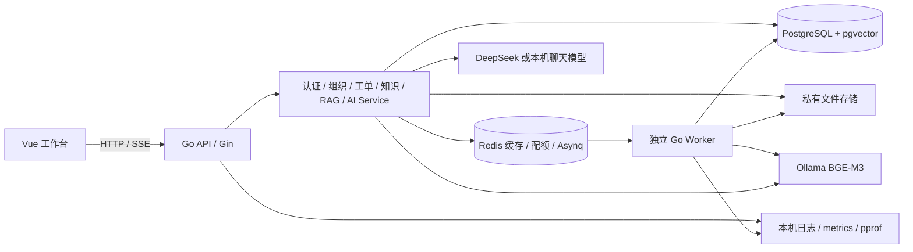

# 当前架构与代码阅读地图

这是 W12 当前实现；[早期架构稿](../architecture.md)保留各周演进背景。项目采用模块化单体 API，加同仓库独立 Worker，无微服务网关或 Kubernetes。

## 从 main 往下读

| 位置 | 负责什么、改动入口 |
|---|---|
| cmd/api/main.go | 配置、日志、资源初始化、依赖注入、HTTP 与诊断监听、退出清理 |
| cmd/worker/main.go | 相同 DB/存储配置，队列消费与任务恢复循环，独立观测 |
| internal/platform | 配置、HTTP、数据库、缓存、队列与观测基础设施；不放领域业务 |
| internal/auth | 密码散列、JWT、登录注册与 RequireUser |
| internal/organization | 组织创建、active 成员关系与 admin/member 权限 |
| internal/ticket | 工单状态机、version、领取/指派/编辑/软删、评论和事件事务 |
| internal/knowledge | 文档元数据、私有对象、正文提取与访问约束 |
| internal/rag | 索引、嵌入、召回、混合排序、引用校验与模型适配 |
| internal/jobs | 持久任务、投递意图、租约、心跳、重试与恢复 |
| internal/ai | 会话、SSE、工具白名单、待确认 action 与幂等写入 |
| web/src/lib/client.ts | JSON bigint、统一错误、Token 绑定与请求作用域 |
| web/src/composables | 各页面异步数据与权限状态；本周新增 members/ticket-management |
| web/src/views / components | 10 个主要页面与共享交互；CSS 延续企业工作台 |

HTTP 的 Handler 负责解码/返回，Service 执行授权与业务事务，Repository 负责 SQL。组织创建等早期代码由专用 Repository 内部持有原子事务；工单等由 Service 显式持有事务，不必为形式统一大改已验证代码。

## 三条关键数据链路

工单写入：认证用户 → 当前组织 active 关系 → 对象策略 → 锁定工单并核对 version/status → 更新与事件写入同一事务 → 提交。修改失败不会留下成功事件；前端 409 只刷新，要求再次确认。删除是管理员软删，当前 DELETE 契约不接收 expected_version，不宣称与编辑相同的版本保护。

文档入库：流式保存私有对象 → 元数据 → PG knowledge_jobs 持久意图 → Redis 通知 → Worker 租约领取 → 事务外提取/模型调用 → 短事务核对 token/run/hash/权限并发布。PG 是任务真相；重复消息或进程退出由租约与状态约束收敛，不能承诺 exactly-once 外部模型调用。

AI 写入：当前用户拥有的会话 → 检索/有限工具 → 提议 action → 人工确认 → 服务端再次授权并创建工单 → action 关联结果。模型只能提出受限结构，不拿用户凭据、不执行任意 SQL/Shell。SSE 使用原生 HTTP 写入生命周期，客户端断开不能当作事务自动回滚证明。

## 数据、缓存与观测

14 个业务表加 cache_revisions 技术表，共 15 表；14 个迁移，Goose 另有迁移历史表，不算业务表。详细列、外键和索引见[数据库设计](../database.md)与 migrations。文档/chunk/job 的 org_id 与父关系共同约束；仅使用 JWT 验签不能替代成员查询。

Redis 元数据缓存不缓存授权结果。写入推进 PG revision，读键带版本；坏缓存回源。AI 配额 Redis 故障保守拒绝，而普通列表缓存故障可回源，两者故障策略不同。性能依据是[实际 profile 与实验](../performance-report.md)，没有宣称生产容量。

业务响应包含服务端生成的 request_id，与完成日志相关联。诊断服务只在显式回环端口、默认关闭。记录的是进程内指标与 runtime trace，未部署 Prometheus 长期存储、Grafana、告警或跨服务分布式追踪。
