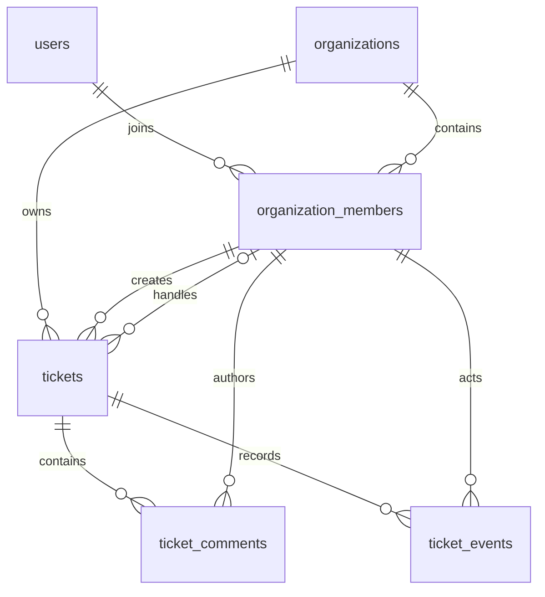

# W03 工单设计

2026-11-10，AI按整周委托整理。已实现并通过专用库验证，实施证据见[week03](weekly/week03.md)，个人独立理解另行记录。

## 用户故事与范围

创建者提交问题：active成员输入title/body，成功为OPEN/version0并有创建事件，伪造身份/组织400，非成员404，事件失败整体回滚。

受理人处理问题：admin将OPEN指派给同组织active Bob，Bob或admin启动/解决，其他member不能操作；未指派或状态跳跃409。

管理员管理问题：可编辑本组织任意OPEN、指派、关闭RESOLVED、重开至IN_PROGRESS、软删除；跨组织404，不增加状态修改/抢单/前端功能。

## 旧契约差异与当前规则

W03全组织active member/admin可读工单/评论/事件，覆盖旧“member仅本人”；admin可编辑他人OPEN；OPEN允许指派，非OPEN必须有assignee。角色仍admin/member，priority沿用1低2普通3高。

title去空白1..200码点、body1..10000、评论1..5000，有效UTF-8且无NUL；密码处理不变。JSON64KiB，拒绝未知/重复字段/无效Unicode，整数严格int64。PATCH可admin将assignee_id设null解除OPEN指派。CLOSED不新增评论。

## 六表关系（ER）

ticket、comment、event都带org_id，子表(org_id,ticket_id)复合FK引用tickets(org_id,id)，creator/assignee/author/actor引用(org_id,user_id)成员键。FK不能保证active或业务动作权限，Service仍查询当前关系。

## 分层与原子性

Service定义Store.Begin返回Transaction，事务内查成员、FOR UPDATE锁定可见父工单、判断权限/状态/版本，再调用SQL更新与InsertEvent；COMMIT后返回。Repository只执行SQL，查询普通3秒、写事务整体5秒，Rollback独立3秒。所有对象SQL限定组织与父工单deleted_at IS NULL。

工单创建/编辑/状态/删除写事件；实际更新version+1，创建version0；同PATCH修改基础字段与指派产生两条事件但只加一次版本。评论插入和事件同tx、锁同工单，不改工单version；事件只记结构化字段，评论只记comment_id，不复制评论正文/凭据/请求头。无实际变更PATCH为400。

查询无total：工单按created_at DESC,id DESC；评论/事件按created_at ASC,id ASC。删除后所有普通接口404，审计行在数据库保留。无请求级幂等键，重复POST创建不同对象；非快照分页不保证跨请求一致性。并发撤权完全线性化仍非本周承诺。

配套：[API](api/ticket.md)、[状态机](ticket-state-machine.md)、[ADR](decisions/0003-ticket-transaction.md)、[测试矩阵](testing/ticket-test-matrix.md)。
